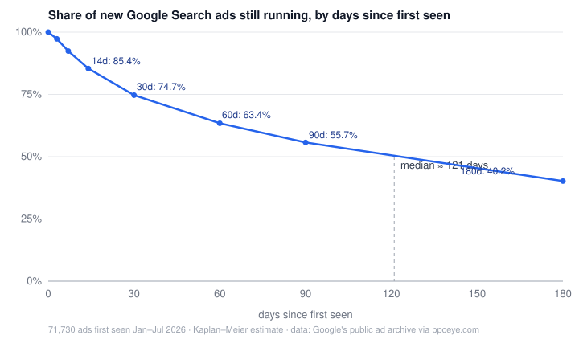

# 一条 Google 搜索广告能活多久？

[English](README.md) · 数据截止：2026-10-12 抽样 · [方法说明](../../METHODOLOGY.zh.md)

## 先说结论

- **新上线的 Google 搜索广告，一半活不过四个月左右**（中位数 121 天）。
- 大约**每 13 条有 1 条活不过一周**，**每 4 条有 1 条活不过一个月**。
- 能跑过半年的，只剩**约四成**。
- 但**你今天看到的广告，一半已经跑了快两年**（中位数 686 天）。

这两件事同时成立：大部分新广告很快被关掉，活下来的少数能跑很多年，而你日常看到的广告位，大多被这些少数占着。

## 两个看着一样的问题

「广告能跑多久」其实是两个问题，答案差得很远。

**一、现在正在展示的广告已经跑了多久？** 取样本里 2026-09-01 以后仍有展示的广告（[`age_of_ads_running_now.csv`](data/age_of_ads_running_now.csv)）：

| 已经跑了 | 占比 |
|---|---|
| 30 天以内 | 3.5% |
| 90 天以内 | 9.4% |
| 超过 1 年 | 70.1% |
| 超过 2 年 | 47.9% |

中位数 686 天。另有 8.3% 的首次展示日期停在 Google 存档的起点（约 2021-10-25），实际只会更老。

**二、一条新广告能活多久？** 686 天回答不了这个问题。某一天正在展示的广告，天然偏向跑得久的：只跑三天的广告，你得恰好在那三天里搜到才看得见；跑两年的，哪天搜都可能碰到。就像随便哪天走进医院，看到的大多是住院时间长的病人。

要回答第二个问题，得选一批同期上线的新广告，从它们上线那天开始跟踪。我们取了样本里 2026 年 1 月到 7 月首次出现的 71,730 条广告。其中很多到今天还在跑，不知道最后能活多久，所以用了生存分析（Kaplan-Meier）：还在跑的广告算作「至少活了这么久」（[`new_ad_survival.csv`](data/new_ad_survival.csv)）。

| 上线后 | 仍在展示 |
|---|---|
| 3 天 | 97.3% |
| 7 天 | 92.4% |
| 14 天 | 85.4% |
| 30 天 | 74.7% |
| 60 天 | 63.4% |
| 90 天 | 55.7% |
| 180 天 | 40.2% |

为了确认不是某个月份的偶然，我们按上线时间分成四段分别算：7 天存活率在 89.5% 到 93.4% 之间，30 天存活率在 64.6% 到 77.5% 之间（[`survival_by_launch_period.csv`](data/survival_by_launch_period.csv)）。

## 大广告主的广告活得更久

| 广告主（按样本内广告数） | 寿命中位数 | 30 天存活 | 90 天存活 |
|---|---|---|---|
| 1–9 条 | 64 天 | 65.9% | 43.0% |
| 10–99 条 | 67 天 | 65.0% | 44.5% |
| 100 条以上 | 185 天 | 84.4% | 67.9% |

按落地域名数分也是同一个方向：只投 1 个域名的广告主，新广告寿命中位数 91 天；投 5 个以上域名的，184 天（[`survival_by_advertiser_size.csv`](data/survival_by_advertiser_size.csv)、[`survival_by_landing_domains.csv`](data/survival_by_landing_domains.csv)）。

广告多、域名多的大广告主，很多是平台、代投公司和大型零售商，广告按商品或按客户批量生成，设好之后很少动。小广告主更多是在试错，换文案、换落地页、换 Offer，上得快下得也快。

## 这组数字能用来干什么

- **看竞争对手的广告。** 搜索广告按点击扣钱，没人会长期为一条亏钱的广告付费。一条广告跑过半年，就已经活得比约六成的同期广告久。投放时间越长的广告，越是被市场验证过的。
- **品牌词维权取证。** 一条投你品牌词的广告跑了 90 天，就已经比将近一半的同期新广告活得久，对方很难再说是「误投」。见[取证材料包](../../evidence-kit/README.zh.md)。
- **看自己的账户。** 小广告主的广告大部分活不过两个月是正常的；但如果跑了半年还没有一条能稳住，就值得停下来查查问题在哪。

## 需要注意

- **真实情况大概率更残酷。** 我们是分批采集的，两次采集之间上线又下线的广告可能没被看到，所以「活不过一周 / 一个月」的比例是下限。
- **「投放时长」是从首次展示到最近展示**，中间可能暂停过。
- **2025 年及以前上线的广告没有用来估算寿命。** 受采集方式影响，这些老批次偏向长寿命。
- **没有花费数据。** Google 存档里没有，所以这里说不了任何广告花了多少、赚了多少。

## 样本怎么抽的

2026-10-12 按广告 ID 全区间均匀抽取 40 万条 Google 搜索广告。一条广告如果在我们最近一次采集到它时的 3 天以内仍有展示，就算作「仍在展示」。广告主规模和落地域名数都按样本内统计。

## 引用

> 竞眼 PPCEye（2026）。《一条 Google 搜索广告能活多久？》，Google 公开广告存档中 40 万条广告样本，2026-10-12 抽样。https://github.com/goodluck8866/google-ads-brand-bidding-research

采用 CC BY 4.0 许可，可自由转载使用，请注明出处并附链接。
